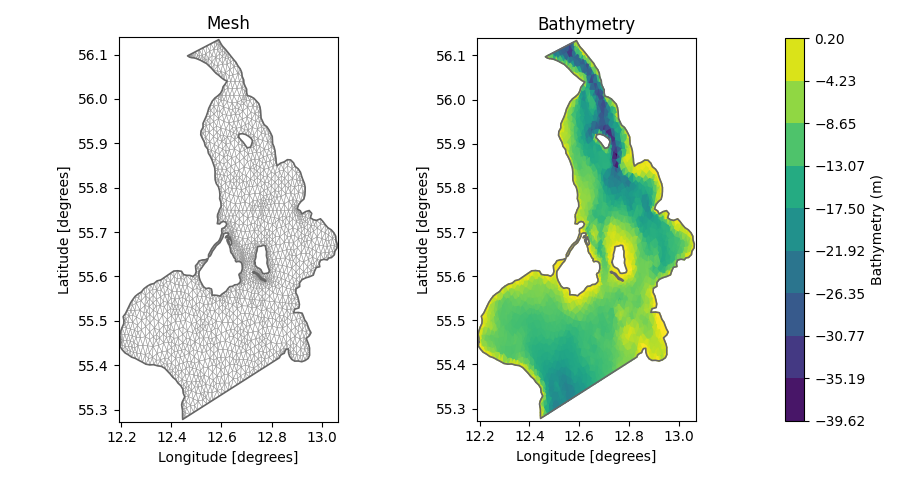
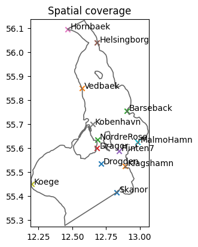
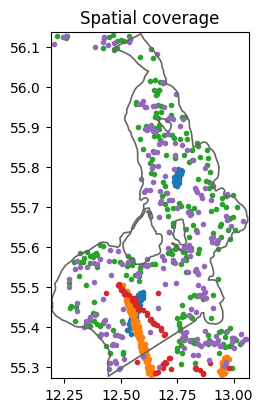
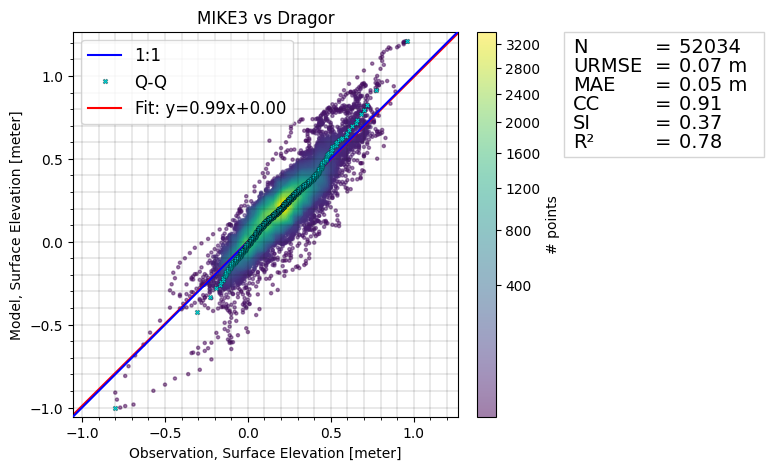
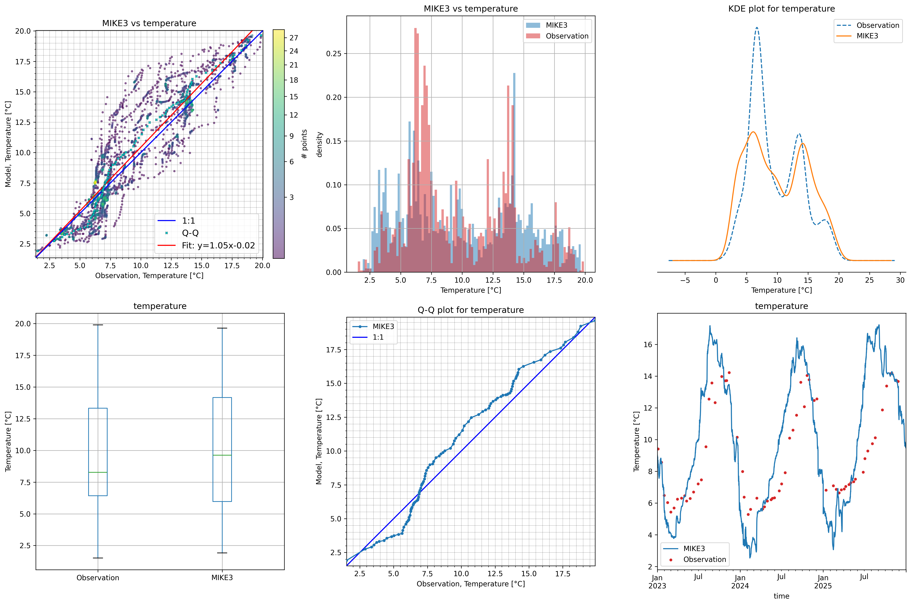
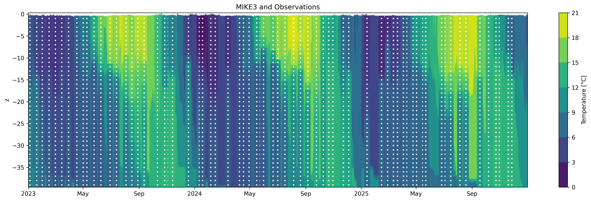

# MIKE3 Hydrodynamic model of Øresund

This dataset is part of the [DHI WaterBench](https://dhi.github.io/WaterBench/) series.

The dataset can be cited as:

> DHI. (2026). Hydrodynamic 3D model of the Øresund: MIKE3 model setup, outputs and observation data [Data set]. Zenodo. [https://doi.org/10.5281/zenodo.20284684](https://doi.org/10.5281/zenodo.20284684)

See the [LICENSE](LICENSE) file for usage conditions.

⚠️ Disclaimer

> This model is not calibrated for operational use. It is intended for educational and \
> research purposes only, and the results must not be used for decision-making. The \
> performance shown here does not reflect that of DHI’s high-resolution models.

# Intended Use

The dataset is aimed at supporting educational, research, and exploratory activities, such as:

-   Development and benchmarking of hydrodynamic or hydrological models
-   Testing model calibration and validation workflows
-   Machine learning and surrogate modelling
-   Extreme event forecasting studies
-   Uncertainty quantification experiments

# Folder Structure

    - README.md
    - LICENSE
    - model/
        + model setup files
        + simulation logs 
    - input/
        + boundary conditions
        + meteorological forcings
        + dispersion file
        + initial conditions
        + mesh file 
    - observations/
        + in-situ observations
        + satellite data
    - code/
        + notebooks for data exploration
        + validation scripts
    - figures/
    - output_sample/
        + reduced model outputs for testing
    - output/
        + full simulation results (only on Zenodo)

# Background
This folder contains data for a simulation with the hydrodynamic MIKE 3 Flow Model FM in the Øresund Strait between Denmark and Sweden. It is an extension of a 2D setup published in 2024 ([https://doi.org/10.5281/zenodo.14160710](https://doi.org/10.5281/zenodo.14160710)). The repository contains the setup file, input data and observation data, as well as simulation result data. The simulation result data is available in [Zenodo](https://doi.org/10.5281/zenodo.20284684). The data supplied in this repository covers the period from 2023-01-01 to 2025-12-31. 

## MIKE 3 Flow Model FM

MIKE 3 Flow Model FM is a 3D modelling system using a flexible mesh to discretize the horizontal dimension and a combination of a sigma and a Cartesian coordinate system for the vertical direction. The modelling system has been developed for applications within oceanographic, coastal and estuarine environments. The governing equations are the incompressible Navier-Stokes equations subject to the assumptions of Boussinesq (density variations are small enough to be ignored, except in gravity term) and with the free surface described by a height function. The current model setup also includes the transport equations for temperature and salinity, which is useful e.g. for ecological modelling or modelling of sediment transport. More information can be found [in the documentation](https://manuals.mikepoweredbydhi.help/latest/Coast_and_Sea/MIKE_3_Flow_FM_Scientific_Doc.pdf).

Since all data, including output from a simulation, is given, it is not necessary to run the MIKE simulation. However, it is possible, since a setup file is supplied as well as all of the input data. Running the MIKE software requires a license. Read more about obtaining a [license](https://www.dhigroup.com/technologies/mikepoweredbydhi/pricing) and about [academic licensing](https://www.dhigroup.com/technologies/mikepoweredbydhi/pricing/academic-licenses). If you already have a license, read the [step-by-step guide](https://manuals.mikepoweredbydhi.help/latest/Coast_and_Sea/MIKE_FM_HD_Step_By_Step.pdf) to learn how to run simulations.

# 3D model of Øresund

The coastal hydrodynamics of Øresund are primarily driven by the surge component introduced at the two open boundaries (one in North and one in South) with tidal ranges of 10-20 cm. The meteorological forcings such as air pressure and wind have only a minor effect. Modelling the hydrodynamics of this area is interesting for many reasons, e.g. surveillance of bacteria in bathing water and sediments around constructions and infrastructure. 

## Model Setup

The Øresund mesh consists of triangular elements in a higher resolution close to the coast than on deeper waters, and for each node a depth value is assigned by interpolating the EMODnet bathymetry data. The mesh is shown in the figure below. It consists of a total of 3320 elements covering the area of approximately 2000 $km^2$.

### Forcings

The model is forced by meteorological inputs and boundary conditions supplied from a larger regional model. The meteorological inputs are:

- wind velocities and air pressure,
- air temperature and relative humidity,
- cloud coverage, precipitation and sea-ice cover. 

The boundary conditions supply:

- vertical cross section of water currents, temperature and salinity on the North and South boundary,
- water levels on the north and south boundary.

The outputs from the model are given as:

- a 3D timeseries of the current velocities (Eastward, Northward, and vertical directions), density, temperature and salinity.
- a 2D timeseries of the water surface elevations and depth-averaged current velocities. 

The 2D timeseries contains values for each mesh element, whereas the 3D timeseries also covers the coordinates in the vertical direction. 

# Validation of model outputs

The outputs of the model are validated against in-situ measurement as well as altimetry data from satellites. For the validation, the [modelskill](https://dhi.github.io/modelskill/) python package is used. Below, some examples of the analyses produced can be seen. The validation scripts can be found in the ./code/ folder. 

## Validation of 2D outputs

The coverage of the validation data is shown in the figure below. The leftmost figure below shows the location of the in-situ measurement locations, and the rightmost figure shows the coverage of the altimetry data.

Below, the comparison between the observational data from one such measurement station and MIKE 3 is shown. The production of these and many more plots is found in the notebooks code/model_validation_2D.ipynb. The figure shows the predicted water surface elevations (y-axis) against the observation data (x-axis). For a perfect fit, the data would follow the 1:1 diagonal line. For this measurement station, the trend in the predictions is close to 1:1, however, the metrics in the table, e.g. unbiased root-mean-squared-error (URMSE), scatter index (SI), and $R^2$, indicate that the approximations are not perfect.

## Validation of 3D outputs

The 3D temperature output from MIKE is compared to observations in the figures below. The plots include a scatter plot (similar to above), an overview of the distribution through histograms and QQ_plot, and a timeseries plot. The bottom figure shows a Hovmöller diagram of the vertical profiles. The figures show that the model captures some overall trends, e.g. the bimodal distributions, but looking at the timeseries, the model is slightly out of phase. This is information that could be used to calibrate the model further. We remind the user that the current model setup has not been calibrated to full capacity, and should therefore only be used for educational, benchmarking, and research purposes, NOT operational setups.

# Data Sources

The data supplied to the MIKE3 model comes from a range of sources. An overview is found in the tables below. While this repository redistributes this data (according to the licenses), it is up to the users of the data to cite the source appropriately.

The following changes have been made to the data:

- Sea levels in measurement stations: Data has been filtered to only include "good" or "probably good" data points according to quality flags. The coordinates of some stations have been moved into the simulation domain, since they are sometimes located so close to land (e.g. in a harbor) that the mesh is not covering it. 
- Current velocities in measurement stations: Data has been filtered to only include "good" data points according to quality flags. Some faulty observations have been removed manually (e.g. zero-values and outliers). The u and v components of the current velocities are calculated from the speed and directions. The data is given at different depths, so depth-averaged values have been calculated.
- Altimetry data: Data has been filtered to only include "good" data points according to quality flags. 

| Data | Source | Citation | License |
|------|--------|----------|--------|
| Mesh | DHI. | Repository citation, see [the top](#MIKE3-Hydrodynamic-model-of-Øresund) | [CC BY 4.0](https://creativecommons.org/licenses/by/4.0/) |
| Bathymetry | EMODnet Bathymetry Digital Terrain Model (DTM) 2020. | EMODnet Bathymetry Consortium (2020). EMODnet Digital Bathymetry (DTM 2020).EMODnet Bathymetry Consortium [https://doi.org/10.12770/bb6a87dd-e579-4036-abe1-e649cea9881a](https://doi.org/10.12770/bb6a87dd-e579-4036-abe1-e649cea9881a) | [CC BY 4.0](https://creativecommons.org/licenses/by/4.0/) |
| Dispersion coefficients | DHI | Repository citation, see [the top](#MIKE3-Hydrodynamic-model-of-Øresund) | [CC BY 4.0](https://creativecommons.org/licenses/by/4.0/) |
| Boundary condition | DHI's Danish Waters and Baltic Sea (DKBS) model. | DHI, ”Water levels and currents on the boundaries of Øresund from the DKBS hydrodynamical model” (2024). | [CC BY 4.0](https://creativecommons.org/licenses/by/4.0/) |
| Meteorological forcing | The ERA5 reanalysis of globate climate. | Hersbach, H., Bell, B., Berrisford, P., Biavati, G., Horányi, A., Muñoz Sabater, J., Nicolas, J., Peubey, C., Radu, R., Rozum, I., Schepers, D., Simmons, A., Soci, C., Dee, D., Thépaut, J-N. (2023): ERA5 hourly data on pressure levels from 1940 to present. Copernicus Climate Change Service (C3S) Climate Data Store (CDS), DOI: 10.24381/cds.bd0915c6 (Accessed on 01-05-2026) | See full license [here](https://apps.ecmwf.int/datasets/licences/copernicus/). Allowed to use and redistribute. |
| Sea levels in measurement stations | [Copernicus Marine Service (CMEMS, or Copernicus Marine Environmental Monitoring Service)](https://www.copernicus.eu/en/copernicus-services/marine). Downloaded from the [Marine Data Store](https://data.marine.copernicus.eu/product/INSITU_BAL_PHYBGCWAV_DISCRETE_MYNRT_013_032/download?dataset=cmems_obs-ins_bal_phybgcwav_mynrt_na_irr_202311--ext--history). | Copernicus Marine Service, "Baltic Sea- In Situ Near Real Time Observations" (2024), [https://doi.org/10.48670/moi-00032](https://doi.org/10.48670/moi-00032). | See full license [here](https://marine.copernicus.eu/user-corner/service-commitments-and-licence). Allowed to use and redistribute for any purpose. |
| Current velocities in measurement stations | SMHI (Meteorological and Hydrological Institute of Sweden).  | Meteorological and Hydrological Institute of Sweden, "Oceanographic observations" (2024), URL: [https://www.smhi.se/data/hitta-data-for-en-plats/ladda-ner-observationer-fran-havet/current](https://www.smhi.se/data/hitta-data-for-en-plats/ladda-ner-observationer-fran-havet/current) (accessed: 2026-05-20) | Publicly available and free to use for all purposes. [Read more](https://www.smhi.se/data/om-smhis-data/smhis-datapolicy) |
| Temperature and salinity measurements | [Danmarks Miljøportal](https://miljoeportal.dk/) | Danmarks Miljøportal (2026), URL: [https://miljoeportal.dk/](https://miljoeportal.dk/) (Accessed: 2026-05-20) | [CC BY 4.0](https://creativecommons.org/licenses/by/4.0/) |

### Altimetry data

The altimetry data is extracted from a range of different sources. The data is based on satellite observations, and the data is downloaded using [DHI's services for marine observation data](https://altimetry.dhigroup.com/). Data sources:

| Satellite name    | Owner|  Link |
| -------- | ------- | ------- |
| Sentinel-3A (3a) | European Space Agency (ESA) |  [https://sentiwiki.copernicus.eu/web/s3-altimetry-instruments](https://sentiwiki.copernicus.eu/web/s3-altimetry-instruments) |
| Sentinel-3B (3b) | European Space Agency (ESA) | [https://sentiwiki.copernicus.eu/web/s3-altimetry-instruments](https://sentiwiki.copernicus.eu/web/s3-altimetry-instruments) |
| CryoSat-2 (c2) | European Space Agency (ESA) |  [https://earth.esa.int/eogateway/catalog/cryosat-products](https://earth.esa.int/eogateway/catalog/cryosat-products)  |
| SARAL (sa) | French National Space Agency (CNES) and Indian Space Research Organisation (ISRO) | [https://podaac.jpl.nasa.gov/dataset/ALTIKA_SARAL_L2_OST_XOGDR](https://podaac.jpl.nasa.gov/dataset/ALTIKA_SARAL_L2_OST_XOGDR) |
| Jason-3 (j3) | National Aeronautics and Space Administration (NASA) and French National Space Agency (CNES) | [https://sealevel.jpl.nasa.gov/missions/jason-3/summary/](https://sealevel.jpl.nasa.gov/missions/jason-3/summary/) |
